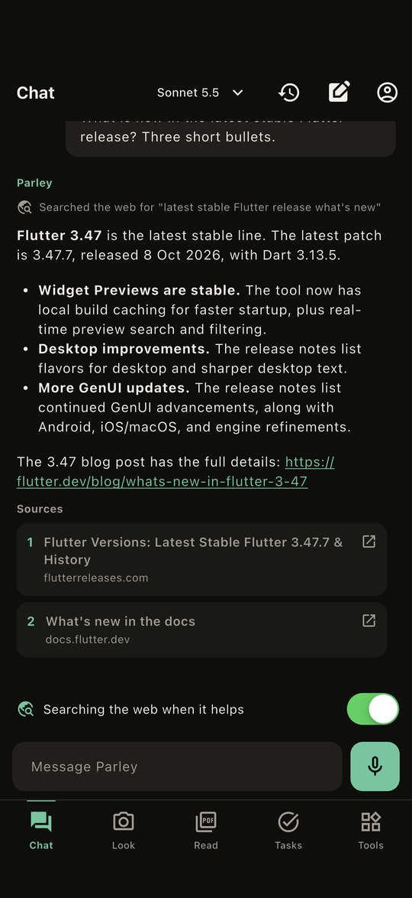
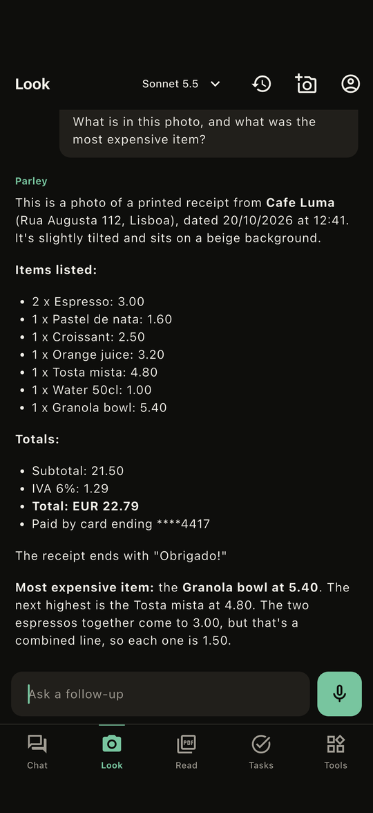
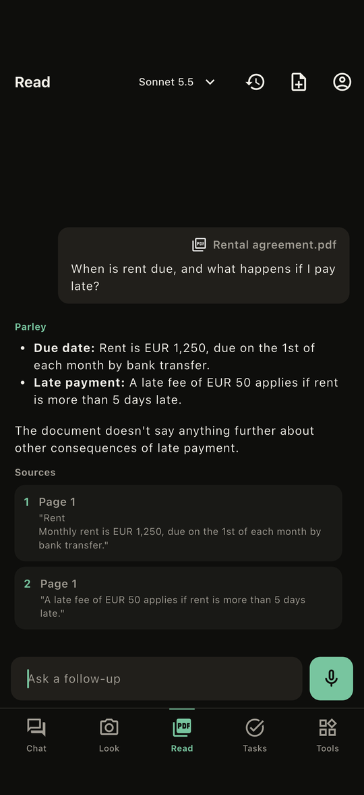
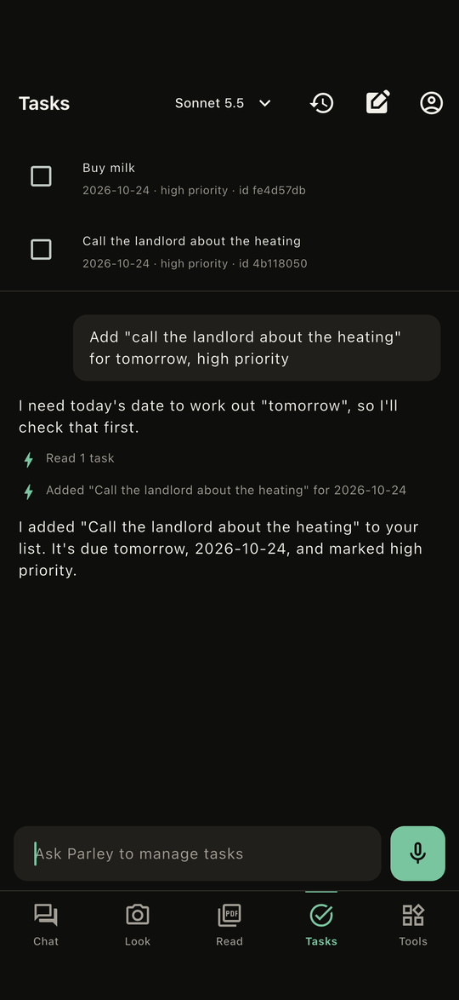
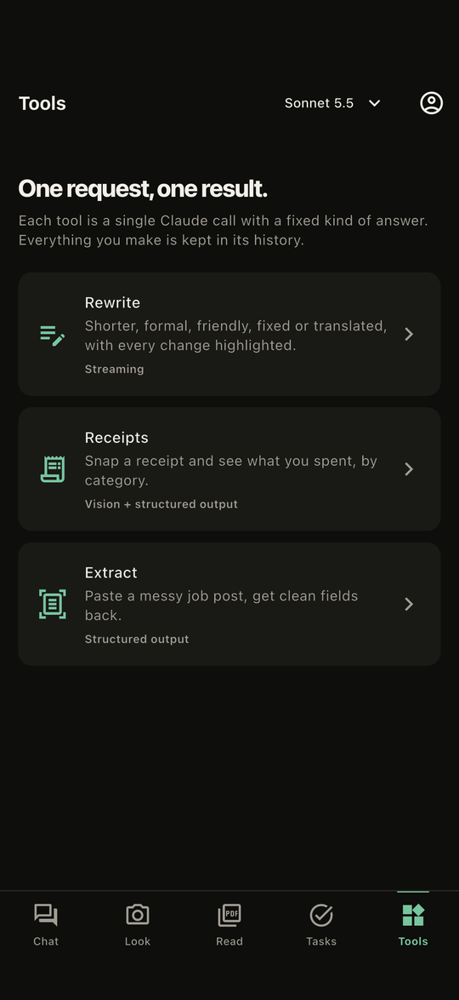
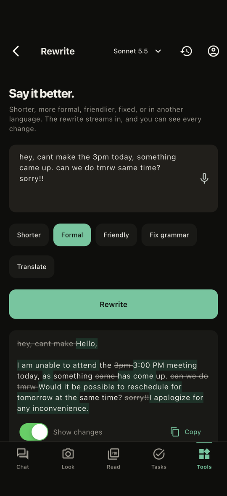
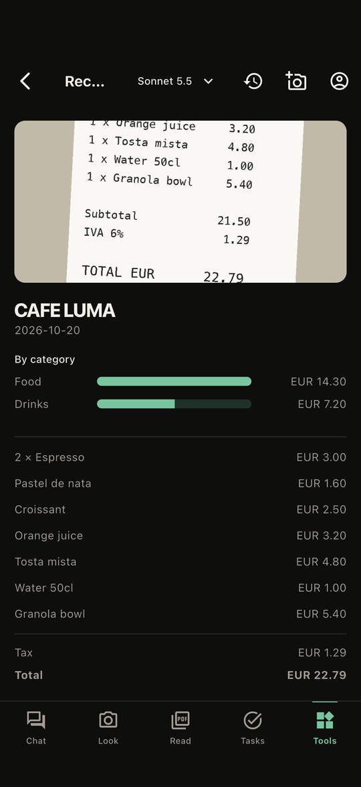
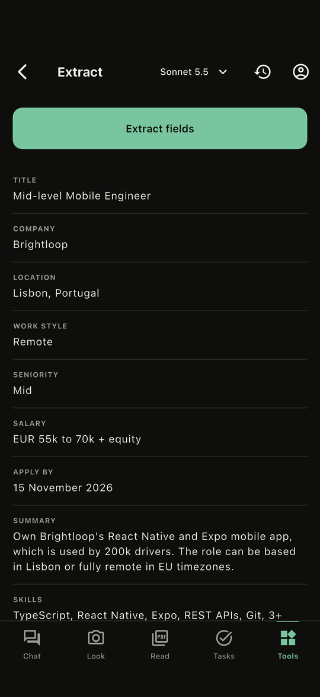

<picture>
  <source media="(prefers-color-scheme: dark)" srcset="brand/banner-dark.svg">
  
</picture>

[](https://github.com/abiodunosagie/parley/actions/workflows/ci.yml)


Parley is an open-source Flutter app that puts the Claude API to work in a real product:
streaming chat with visible reasoning, live web answers with sources, questions about photos
and PDFs with page-level citations, structured output, and an agent that runs tools on the
phone. Every feature is a working screen, not a demo snippet, on a backend that keeps the API
key off the device and every user inside hard limits.

## What it shows

| Screen | What you do | Claude API feature |
| --- | --- | --- |
| **Chat** | Ask anything; flip on web search for current answers | Streaming, adaptive thinking summaries, web search tool, citations |
| **Look** | Take or pick a photo, then ask about it | Vision |
| **Read** | Open a PDF and ask questions; every answer shows the page and the quote | PDF documents with citations |
| **Tasks** | "Add milk for tomorrow, remind me at 6" | Tool use: an agent loop whose tools run on the phone |
| **Rewrite** | Shorter, formal, friendly, fixed or translated, with the changes highlighted | Streaming with a fixed instruction |
| **Receipts** | Snap a receipt, see spending by category | Vision plus structured output |
| **Extract** | Paste a messy job post, get clean fields | Structured output (JSON schema) |

Also in every screen: history saved on the phone per account (reopen and carry on, or delete),
on-device voice dictation with a live waveform, three models to choose from (Haiku, Sonnet,
Opus), and light and dark mode.

## Screens

Captured from the real app talking to the real backend (`integration_test/screenshots_test.dart`).

| Chat with web search | Look | Read a PDF | Tasks agent |
| --- | --- | --- | --- |
|  |  |  |  |

| Tools | Rewrite | Receipts | Extract |
| --- | --- | --- | --- |
|  |  |  |  |

## How it is built

```
Flutter app                          Supabase                                Anthropic API
  features/<name>/                     Edge function "claude"                  Claude Haiku 5.5
    domain/      plain Dart            1. body size, streamed byte limit       Claude Sonnet 5.5
    data/        repositories          2. signed-in user                       Claude Opus 5.5
    presentation/ Riverpod + screens   3. every block rebuilt from an allowlist
  core/  network, storage, speech      4. atomic per-user, per-network and
  holds NO API key                        project limits (one locked SQL call)
                                       5. call Claude, stream back, log spend
```

- **Clean architecture, enforced.** `test/architecture_test.dart` fails the build if a domain file
  imports Flutter, a feature reaches into another, a widget calls HTTP, or a file passes 300 lines.
- **Riverpod for all state**, GoRouter for navigation (auth redirect, five tabs that keep their state).
- **The server trusts nothing.** The app is open source, so the edge function treats every field as
  hostile: allowed models and block types per mode, server-side system prompts and tool
  definitions, and Claude's earlier turns rebuilt field by field before they are replayed.
- **Spend is capped and counted honestly.** Requests, tokens and web searches are limited per
  user per day, and a request the app abandons mid-stream is still logged.
- **History never leaves the phone.** Saved per account in the app's own storage and kept out of
  iCloud and Android backups.

The [code tour](docs/CODE_TOUR.md) walks one request from the Send button to Claude and back.

## Run it

You need Flutter 3.47+, the Supabase CLI, and an Anthropic API key.

```bash
git clone https://github.com/abiodunosagie/parley.git && cd parley
supabase link --project-ref <your-project-ref>
supabase db push --linked
supabase functions deploy claude
supabase functions deploy delete-account
supabase secrets set ANTHROPIC_API_KEY=<your key>
cp config/parley.example.json config/parley.json   # your project URL and publishable key
flutter run --dart-define-from-file=config/parley.json
```

The [runbook](RUNBOOK.md) covers backend setup, logs and troubleshooting in detail.

## Tests

```bash
flutter analyze && flutter test                              # 100 tests: entities, controllers, storage, the whole app
cd supabase/functions/claude && deno check index.ts && deno test   # request and replay validation
```

## Brand

The mark is two half-discs facing across a gap, one a step higher: two parties taking turns at
the table. Masters, colours and rules are in [brand/BRAND.md](brand/BRAND.md).

## License

[MIT](LICENSE). Built by [Abiodun Osagie](https://github.com/abiodunosagie).
